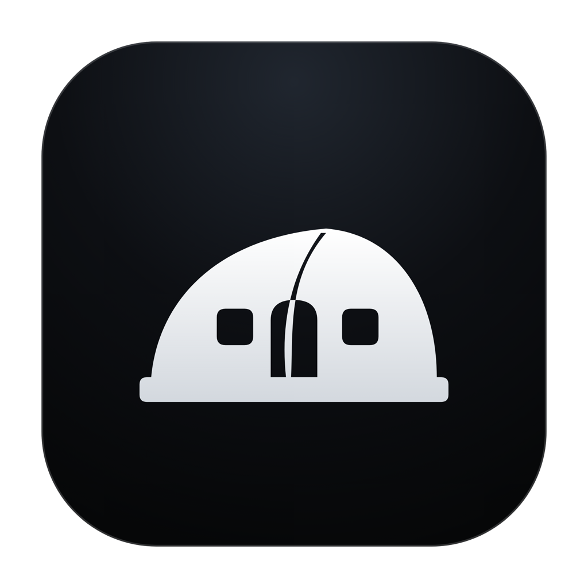
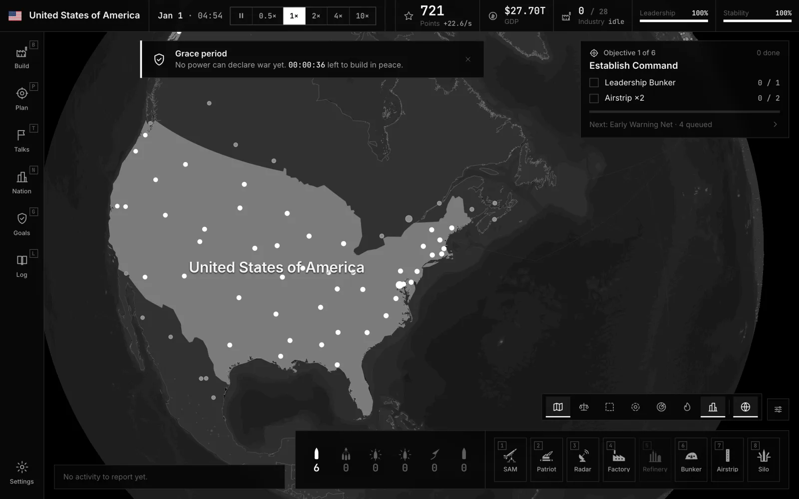
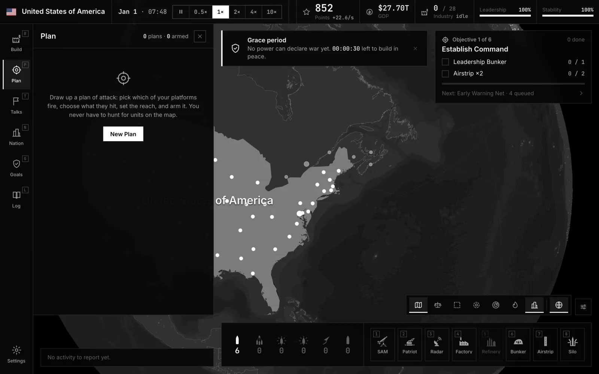

<p align="center">
  
</p>

<h1 align="center">DomeBreak</h1>

<p align="center">A real-time missile strategy game played on the real world map.</p>

<p align="center"><a href="https://domebreak.com">domebreak.com</a> · <a href="https://domebreak.com/#/download">Download</a> · <a href="https://domebreak.com/#/wiki">Unit wiki</a></p>

<p align="center">
  
</p>

You pick one of 222 nations and run it in real time: build radar and interceptors over your cities, put silos, warships and jets where they can reach your rivals, and keep the economy going while missiles are in the air. Play against up to eleven AI nations, or online against other players. It's free, and it runs as a desktop app on macOS and Windows.

It's my own game, published under TaylorURL. The game, the multiplayer server and the website all live in this repo.

<p align="center">
  
  
</p>

## How to play

1. Start a **New Game**, pick your nation and how many AI rivals you face. You can choose which nations they are.
2. The game opens with a short grace period when nobody can declare war. Use it to build.
3. The Goals panel walks you through six objectives, from setting up command to fielding a strike force.
4. Cover your cities with radar and air defense. Your income comes from your cities, so losing them hurts.
5. Open **Plan**, pick your attackers and target nations, and launch.

The clock can be paused or run from 0.5x to 10x, and single-player games save automatically. **Continue** picks up where you left off. The [unit wiki](https://domebreak.com/#/wiki) lists every unit and building with its cost, range and build time.

## What's in it

- Real countries, cities, coastlines and borders, on a globe or a flat map
- Land, sea, air and space units: SAMs, Patriot, THAAD, laser defense, silos, hypersonic missiles, carriers, submarines, bombers and satellites
- Warheads from conventional to thermonuclear MIRVs, each with its own cost and build time
- An economy tied to city health, so hitting a rival's cities shrinks what they can build
- Diplomacy with the other nations
- Online matches with lobbies, parties and friends, with cross-play between Mac and Windows

## Running it locally

```bash
npm install
npm run dev
```

The game opens at http://localhost:5173 in the browser. Single-player needs no setup. For accounts and multiplayer, copy `.env.example` to `.env` and fill in `VITE_SUPABASE_URL` and `VITE_SUPABASE_ANON_KEY`. Needs Node 22.

`npm test` runs the test suite, and `npm run build` makes the production build in `dist/`.

## Desktop builds

```bash
npm run build && npm run electron   # run the desktop app against the build
npm run electron:build:mac          # macOS .dmg, Apple Silicon and Intel
npm run electron:build:win          # Windows installer
```

Installers land in `release/`. A Linux AppImage target is set up too if you want to build one yourself.

## Project layout

| Folder      | What's there                                                                             |
| :---------- | :--------------------------------------------------------------------------------------- |
| `src/`      | The game: engine, map, UI and networking                                                 |
| `electron/` | Desktop app and its auto-updater                                                         |
| `server/`   | Multiplayer match server (`npm start`), set up by the `GD_*` variables in `.env.example` |
| `supabase/` | Database migrations and edge functions for accounts and lobbies                          |
| `web/`      | The domebreak.com site: landing page, downloads and wiki                                 |
| `tests/`    | Vitest suites                                                                            |

## Built with

React 19, Vite, Tailwind CSS, MapLibre GL, Electron, Supabase, and a Node WebSocket server for multiplayer.

## Credits

Unit icons are from [game-icons.net](https://game-icons.net) (Lorc, Delapouite) under CC BY 3.0.

## License

Proprietary. See [LICENSE.md](LICENSE.md). The game-icons.net icons keep their own license.
